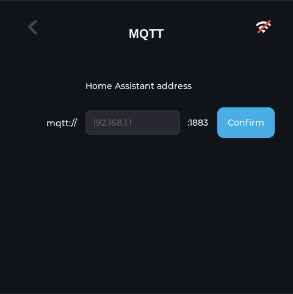

# SenseCAP Indicator Home Assistant Firmware

Firmware for using the [Seeed Studio SenseCAP Indicator](https://www.seeedstudio.com/SenseCAP-Indicator-D1-p-5643.html)
as a Home Assistant control panel. It connects over Wi-Fi and exposes shared
sensor/control state through ESPHome Native API, optional MQTT, and the
touchscreen.

[](https://github.com/Love4yzp/sensecap-indicator-ha/actions/workflows/firmware.yml)

<figure class="third">
    
    
    
    
</figure>

---

## Features

- Wi-Fi and optional MQTT setup from the touchscreen
- Native API enabled by default for mDNS discovery or manual IP setup
- Four temperature/humidity/CO₂/tVOC sensors, six switches, and two numbers
- Shared state across touch, Native API, and the unchanged MQTT topics/payloads
- Independent Native/MQTT enablement; local controls keep working offline
- NVS-backed Wi-Fi, transport, and display settings; runtime entity state stays in RAM
- Optional fixed Noise PSK for Native; plaintext mode has an explicit security risk
- Serial commands for Native/MQTT configuration and diagnostics
- Desktop simulator for UI work without hardware

## Install

### Use a release bundle

New `v*` tag builds can include a checksummed `*-click-deploy.zip` bundle for
both chips. Older releases may not have this asset.

After extracting the bundle, connect the Indicator over USB-C and run:

```bash
# macOS or Linux
./macos_linux/install.sh
./macos_linux/flash_all.sh
```

```powershell
# Windows PowerShell
.\windows\flash_all.ps1
```

See [`click_deploy/README.md`](click_deploy/README.md) for port selection and
single-chip flashing.

### Build from source

The ESP32-S3 build uses ESP-IDF v5.5.6.

```bash
git clone https://github.com/Love4yzp/sensecap-indicator-ha.git
cd sensecap-indicator-ha

export IDF_PATH=/path/to/esp-idf
./dev build
./dev flash
./dev monitor
```

On Windows, use `dev.bat build`, `dev.bat flash`, and `dev.bat monitor`.

After flashing, configure Wi-Fi and add the device through Home Assistant's
ESPHome integration. Native needs no broker; configure MQTT only if using that
optional integration.

## Hardware split

| Chip | Responsibility |
| --- | --- |
| ESP32-S3 | Display, touch, Wi-Fi, Native API, MQTT, Home Assistant logic, and settings storage |
| RP2040 | Built-in and Grove sensor acquisition |

The RP2040 sends sensor data to the ESP32-S3 over a COBS-framed UART link at
115200 baud. Sensor drivers stay on the RP2040.

See [`main/ARCHITECTURE.md`](main/ARCHITECTURE.md) for module boundaries and
runtime details.

## Home Assistant: Native API and MQTT

### Native API (default, no broker required)

On a fresh device, or whenever the `native-enabled` NVS key is absent, Native API
defaults to enabled. No MQTT broker or MQTT YAML is required. An explicit
`native disable` stores false and keeps Native off until re-enabled.

When the device has an IP address, it listens on TCP port 6053 and advertises
`_esphomelib._tcp.local.` over mDNS. Automatic discovery requires mDNS multicast
traffic to reach Home Assistant. If multicast is blocked or the two endpoints
are on different subnets, use manual IP setup instead. An mDNS failure does not
disable the IP listener.

To add the device to Home Assistant:

1. Configure Wi-Fi on the Indicator and note its IP address.
2. In Home Assistant, open **Settings → Devices & services**.
3. If the ESPHome device appears under discovered devices, select it. Otherwise
   choose **Add Integration → ESPHome**.
4. For manual setup, enter the Indicator's IP address or resolvable hostname and
   port **6053**.
5. If no PSK is configured, leave the encryption-key field blank. If a PSK is
   configured, enter the same base64 key used on the Indicator.

After onboarding, the ESPHome device page shows all 12 entities: Temp, Humidity,
tVOC, and CO2 sensors; Switch1–Switch4 and Switch6–Switch7; and two numbers named
Switch5 and Switch8 to preserve the legacy control mapping. Home Assistant does
**not** automatically create dashboard cards for them; add the desired entities
to a dashboard separately.

Touch, Native, and MQTT commands share one authoritative in-memory state. A local
command accepted by that state core remains effective while MQTT or HA is offline;
transport failure does not roll it back. Controls cold-start at zero and sensors
start as missing until data arrives. Runtime values are not persisted to NVS;
reconnecting a transport synchronizes the latest snapshots rather than restoring
old NVS state.

Validated on 2026-11-03 with **Home Assistant Container 2026.9.1** (using
`aioesphomeapi` 46.2.0): manual-IP onboarding exposed all 12 entities and real-HA
switch/number API control passed. Separate `aioesphomeapi` 46.6.0 client tests
also passed. See the [current acceptance record](docs/stability/hardware-smoke-checklist.md#current-nativeha-acceptance-result-2026-11-03)
for the tested hardware, Noise/MQTT results, and remaining untested items; HA's
automatic-discovery UI and real-HA PSK onboarding are not claimed as verified.

### Native security and optional Noise PSK

**Without a PSK—the default—Native API is plaintext and unauthenticated.** Any
client that can reach port 6053 can read states and send control commands. Use a
trusted/isolated LAN or configure a unique, cryptographically random 32-byte PSK
for each device. MQTT TLS does not protect Native API traffic.

Generate a unique key on the host, then enter its base64 value through the
serial console and in Home Assistant:

```bash
openssl rand -base64 32
```

```text
native psk <base64-encoded-32-byte-random-key>
native status
```

With a PSK configured, Native requires
`Noise NNpsk0 (Curve25519, ChaChaPoly, SHA-256)`; plaintext connections are
rejected and there is no silent downgrade. `native psk clear` deliberately
returns Native to plaintext. The PSK is a fixed shared credential: dynamic
provisioning, automatic rotation, per-client authorization, and flash/NVS
encryption are not implemented. Status and command output do not print the
secret, but the serial console itself is unauthenticated.

### MQTT (optional, existing compatibility)

The existing MQTT integration remains available alone or together with Native.
To use **only MQTT**, disable Native with `native disable` before adding the MQTT
entities. It uses the same three topics and payload formats:

| Direction | Topic | Example |
| --- | --- | --- |
| Indicator to Home Assistant | `indicator/sensor` | `{"temp":"23.5","humidity":"45","co2":"450","tvoc":"100"}` |
| Home Assistant to Indicator | `indicator/switch/set` | `{"switch1":1,"switch5":50}` |
| Indicator state | `indicator/switch/state` | `{"switch1":1,"switch2":0}` |

To connect through MQTT:

1. Install an MQTT broker such as Mosquitto and enable the MQTT integration.
2. Enter the broker details on the Indicator or use the `setmqtt` serial command.
3. Add [`examples/homeassistant/mqtt-entities.yaml`](examples/homeassistant/mqtt-entities.yaml)
   under the `mqtt:` section of `configuration.yaml`.
4. Add [`examples/homeassistant/dashboard.yaml`](examples/homeassistant/dashboard.yaml)
   through the Lovelace Raw Configuration Editor.

MQTT Discovery is not implemented; the MQTT path still uses these manual YAML
entities. These definitions and MQTT topics are not used by Native API. Native
and MQTT have independent enable settings and lifecycles; changing one does not
restart the other or clear current state. With no `mqtt-enabled` key, a fresh
device enables MQTT only after a valid broker configuration has been stored;
an explicit `mqtt disable` keeps it off.

See the [Seeed Studio Home Assistant guide](https://wiki.seeedstudio.com/SenseCAP_Indicator_Application_Home_Assistant/)
for the original MQTT setup walkthrough.

## Build and flash

The `./dev` command is the main entry point:

```bash
./dev build              # clean ESP32-S3 build
./dev build --no-clean   # incremental build
./dev flash              # flash at 460800 baud
./dev monitor
./dev fullclean
```

If both USB endpoints are present, verify the port before passing `-p`. On the
validated CH340 unit, `/dev/ttyUSB0` is the ESP32-S3 and `/dev/ttyACM0` is the
RP2040.

```bash
./dev flash -p /dev/ttyUSB0
```

The RP2040 firmware only needs rebuilding when its sensor or UART code changes:

```bash
./dev rp2040 build
./dev rp2040 upload
./dev rp2040 monitor
```

## Serial commands

Connect to the ESP32-S3 console at 115200 baud.

| Command | Purpose |
| --- | --- |
| `native status` | Show Native enable/IP/listener/client and redacted PSK status |
| `native enable` / `native disable` | Enable or disable only Native API |
| `native psk <32-byte-key-as-base64>` | Configure a fixed Noise PSK; command result/status stay redacted |
| `native psk clear` | Clear the PSK and allow plaintext Native |
| `mqtt status` | Show MQTT enable/config/client/connection status |
| `mqtt enable` / `mqtt disable` | Enable or disable only MQTT |
| `mqtthelp` | Show MQTT configuration and payload examples |
| `haconfig` | Show saved MQTT settings; Native status is under `native status` |
| `setmqtt -a <addr>` | Set the broker address |
| `setmqtt -a <addr> -c <client-id> -u <user> -p <pass>` | Set the complete broker configuration |
| `setmqtt --insecure` / `--secure` | Skip / re-enable TLS server verification (mqtts only) |
| `setmqttca` / `setmqttca -c` | Paste a CA certificate for `mqtts://`, or clear it |

Examples:

```text
setmqtt -a 192.168.1.10 -c indicator-01 -u mqtt_user -p mqtt_password
setmqtt --addr mqtt://192.168.1.10:1883
```

The firmware saves a successful `setmqtt` update to NVS and reconfigures the MQTT
client; connection starts only when MQTT is enabled and the device has an IP.

### MQTT TLS (`mqtts://`)

Use an `mqtts://` broker URL to encrypt the MQTT connection (the port defaults
to 8883). The touchscreen MQTT page stays plaintext-only; TLS is configured from
the serial console.

Verification order: a stored CA if present, otherwise the public CA bundle (for
cloud brokers with real certificates). LAN brokers with a self-signed or private
CA need `setmqttca`. `setmqtt --insecure` skips verification and is meant for
quick testing only.

With Home Assistant's Mosquitto add-on, set `certfile`/`keyfile`/`cafile` in the
add-on configuration to expose a TLS listener on 8883, paste the CA into
`setmqttca`, then point `setmqtt` at `mqtts://<HA-host>:8883`.

### Security notes

Wi-Fi/MQTT credentials and the Native PSK are stored in plaintext in NVS, and the
serial console is unauthenticated—physical or USB access can expose them. Use a
dedicated MQTT user with a limited ACL, protect console access, and use a unique
Native PSK per device. Before reselling or disposing of the device, run
`idf.py erase-flash` to wipe stored credentials and keys.

## Development

Run the host checks before building or opening a pull request:

```bash
python3 scripts/dev_check.py --skip-build
```

For separate client-level Native verification, install the pinned dependencies
from `scripts/requirements-native-api-integration.txt` in an isolated environment,
then run the host-side `aioesphomeapi` 46.6.0 client against a target endpoint:

```bash
python3 scripts/test_native_api_integration.py --host <device-ip>
python3 scripts/test_native_api_integration.py --host <device-ip> \
  --psk <base64-psk> --negative-tests
```

This script checks the API connection, entities/snapshots, commands, sensor push,
and optional wrong-key/plaintext rejection. It does not itself validate mDNS or
the Home Assistant UI. Keep its 46.6.0 client results distinct from the real-HA
Container 2026.9.1 path. Both sets of completed checks—and the scenarios still
untested—are linked from the [current acceptance record](docs/stability/hardware-smoke-checklist.md#current-nativeha-acceptance-result-2026-11-03).

Build the desktop simulator with:

```bash
cmake -S sim -B sim/build
cmake --build sim/build -j4
./sim/build/sensecap_sim
```

GitHub CI runs host checks and clean builds for both chips on pull requests and
pushes to `main`. Build artifacts are kept for 14 days. A `v*` tag also creates
checksummed release packages. See [`docs/ci-cd.md`](docs/ci-cd.md) for details.

## Versions

| Component | Version |
| --- | --- |
| ESP32-S3 firmware | `v1.1.0` |
| RP2040 firmware | `v2.1.0` |
| ESP-IDF | `v5.5.6` |
| LVGL | `v9.6.0~1` |
| esp_lvgl_port | `v2.9.0` |
| RP2040 build system | PlatformIO `6.2.0` |
