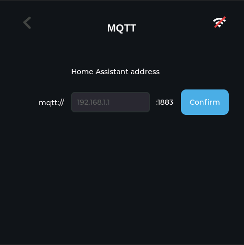

# SenseCAP Indicator Home Assistant Firmware

Firmware for using the [Seeed Studio SenseCAP Indicator](https://www.seeedstudio.com/SenseCAP-Indicator-D1-p-5643.html)
as a Home Assistant control panel. It connects over Wi-Fi, publishes sensor
readings through MQTT, and keeps its touchscreen controls in sync with Home
Assistant.

[](https://github.com/Love4yzp/sensecap-indicator-ha/actions/workflows/firmware.yml)

<figure class="third">
    
    
    
    
</figure>

---

## Features

- Wi-Fi and MQTT setup from the touchscreen
- Temperature, humidity, CO₂, and tVOC publishing
- Six binary controls and two numeric controls for Home Assistant
- MQTT state synchronization in both directions
- NVS-backed Wi-Fi, MQTT, and control settings
- Display brightness and sleep controls
- Serial commands for MQTT configuration and diagnostics
- Desktop simulator for UI work without hardware

## Install

### Use a release bundle

New `v*` tag builds can include a checksummed `*-click-deploy.zip` bundle for
both chips. Older releases may not have this asset.

After extracting the bundle, connect the Indicator over USB-C and run:

```bash
# macOS or Linux
./macos_linux/install.sh
./macos_linux/flash_all.sh
```

```powershell
# Windows PowerShell
.\windows\flash_all.ps1
```

See [`click_deploy/README.md`](click_deploy/README.md) for port selection and
single-chip flashing.

### Build from source

The ESP32-S3 build uses ESP-IDF v5.5.6.

```bash
git clone https://github.com/Love4yzp/sensecap-indicator-ha.git
cd sensecap-indicator-ha

export IDF_PATH=/path/to/esp-idf
./dev build
./dev flash
./dev monitor
```

On Windows, use `dev.bat build`, `dev.bat flash`, and `dev.bat monitor`.

After flashing, configure Wi-Fi and MQTT on the device, then add the Home
Assistant entities described below.

## Hardware split

| Chip | Responsibility |
| --- | --- |
| ESP32-S3 | Display, touch, Wi-Fi, MQTT, Home Assistant logic, and persistent settings |
| RP2040 | Built-in and Grove sensor acquisition |

The RP2040 sends sensor data to the ESP32-S3 over a COBS-framed UART link at
115200 baud. Sensor drivers stay on the RP2040.

See [`main/ARCHITECTURE.md`](main/ARCHITECTURE.md) for module boundaries and
runtime details.

## Home Assistant and MQTT

The firmware uses three MQTT topics:

| Direction | Topic | Example |
| --- | --- | --- |
| Indicator to Home Assistant | `indicator/sensor` | `{"temp":"23.5","humidity":"45","co2":"450","tvoc":"100"}` |
| Home Assistant to Indicator | `indicator/switch/set` | `{"switch1":1,"switch5":50}` |
| Indicator state | `indicator/switch/state` | `{"switch1":1,"switch2":0}` |

To connect it to Home Assistant:

1. Install an MQTT broker such as Mosquitto and enable the MQTT integration.
2. Enter the broker details on the Indicator or use the `setmqtt` serial command.
3. Add [`examples/homeassistant/mqtt-entities.yaml`](examples/homeassistant/mqtt-entities.yaml)
   under the `mqtt:` section of `configuration.yaml`.
4. Add [`examples/homeassistant/dashboard.yaml`](examples/homeassistant/dashboard.yaml)
   through the Lovelace Raw Configuration Editor.

See the [Seeed Studio Home Assistant guide](https://wiki.seeedstudio.com/SenseCAP_Indicator_Application_Home_Assistant/)
for the original setup walkthrough.

## Build and flash

The `./dev` command is the main entry point:

```bash
./dev build              # clean ESP32-S3 build
./dev build --no-clean   # incremental build
./dev flash              # flash at 460800 baud
./dev monitor
./dev fullclean
```

If both USB endpoints are present, verify the port before passing `-p`. On the
validated CH340 unit, `/dev/ttyUSB0` is the ESP32-S3 and `/dev/ttyACM0` is the
RP2040.

```bash
./dev flash -p /dev/ttyUSB0
```

The RP2040 firmware only needs rebuilding when its sensor or UART code changes:

```bash
./dev rp2040 build
./dev rp2040 upload
./dev rp2040 monitor
```

## Serial commands

Connect to the ESP32-S3 console at 115200 baud.

| Command | Purpose |
| --- | --- |
| `mqtthelp` | Show MQTT configuration and payload examples |
| `haconfig` | Show the saved MQTT and Home Assistant settings |
| `setmqtt -a <addr>` | Set the broker address |
| `setmqtt -a <addr> -c <client-id> -u <user> -p <pass>` | Set the complete broker configuration |
| `setmqtt --insecure` / `--secure` | Skip / re-enable TLS server verification (mqtts only) |
| `setmqttca` / `setmqttca -c` | Paste a CA certificate for `mqtts://`, or clear it |

Examples:

```text
setmqtt -a 192.168.1.10 -c indicator-01 -u mqtt_user -p mqtt_password
setmqtt --addr mqtt://192.168.1.10:1883
```

The firmware saves a successful `setmqtt` update to NVS and restarts the MQTT
client.

### TLS (`mqtts://`)

Use an `mqtts://` broker URL to encrypt the MQTT connection (the port defaults
to 8883). The touchscreen MQTT page stays plaintext-only; TLS is configured from
the serial console.

Verification order: a stored CA if present, otherwise the public CA bundle (for
cloud brokers with real certificates). LAN brokers with a self-signed or private
CA need `setmqttca`. `setmqtt --insecure` skips verification and is meant for
quick testing only.

With Home Assistant's Mosquitto add-on, set `certfile`/`keyfile`/`cafile` in the
add-on configuration to expose a TLS listener on 8883, paste the CA into
`setmqttca`, then point `setmqtt` at `mqtts://<HA-host>:8883`.

### Security notes

MQTT and Wi-Fi credentials are stored in plaintext in NVS, and the serial
console is unauthenticated — anyone with physical or USB access can read them
back. Use a dedicated MQTT user with a limited ACL so a leaked credential cannot
reach the rest of your broker. Before reselling or disposing of the device, run
`idf.py erase-flash` to wipe stored credentials.

## Development

Run the host checks before building or opening a pull request:

```bash
python3 scripts/dev_check.py --skip-build
```

Build the desktop simulator with:

```bash
cmake -S sim -B sim/build
cmake --build sim/build -j4
./sim/build/sensecap_sim
```

GitHub CI runs host checks and clean builds for both chips on pull requests and
pushes to `main`. Build artifacts are kept for 14 days. A `v*` tag also creates
checksummed release packages. See [`docs/ci-cd.md`](docs/ci-cd.md) for details.

## Versions

| Component | Version |
| --- | --- |
| ESP32-S3 firmware | `v1.1.0` |
| RP2040 firmware | `v2.1.0` |
| ESP-IDF | `v5.5.6` |
| LVGL | `v9.6.0~1` |
| esp_lvgl_port | `v2.9.0` |
| RP2040 build system | PlatformIO `6.2.0` |
